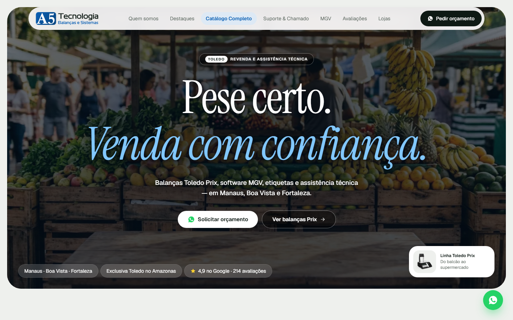
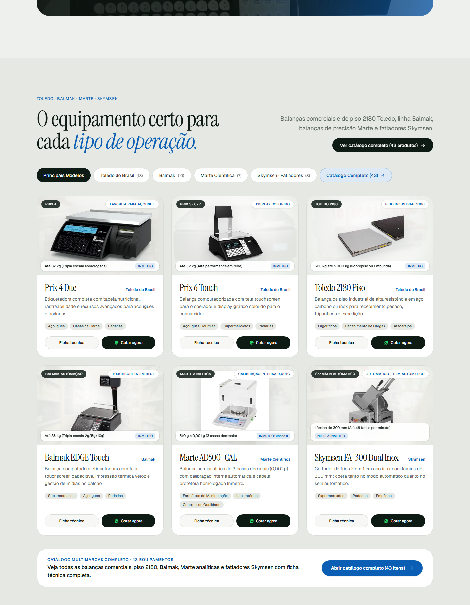
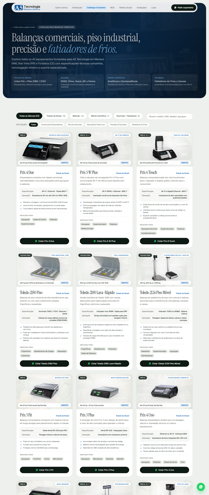
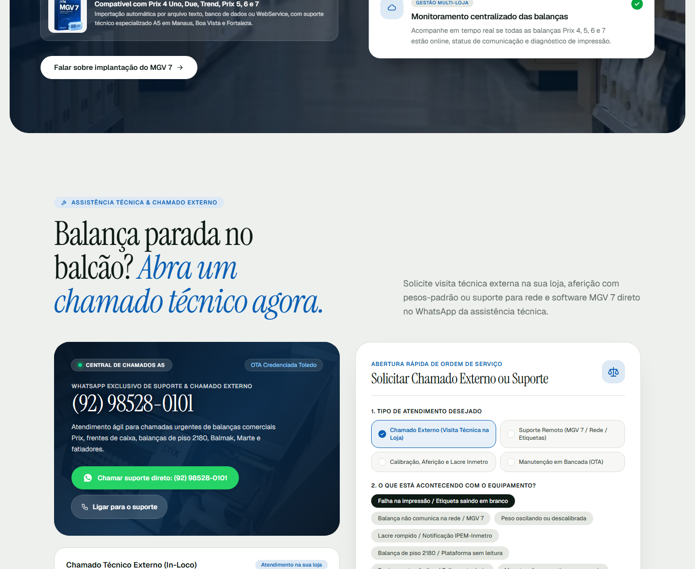

# A5 Tecnologia — Balanças, Sistemas e Etiquetas

Website institucional e catálogo comercial de alta performance para a **A5 Tecnologia**, revenda e assistência técnica autorizada especializada em pesagem comercial, automação, etiquetadoras, balanças industriais de piso e fatiadores profissionais.

Com unidades físicas em **Manaus (AM)** (Matriz Boulevard e Filial Joaquim Nabuco), **Boa Vista (RR)** e **Fortaleza (CE)**.

---

## 📸 Demonstração Visual

### 1. Início / Hero Editorial
Design minimalista e sofisticado com tipografia editorial, selos de homologação e chamada para ação rápida.



---

### 2. Vitrine Simplificada na Página Inicial
Exibição ágil dos principais equipamentos com modal de ficha técnica em 1 clique e botão de cotação direta no WhatsApp.



---

### 3. Catálogo Completo Multimarcas (`/catalogo`)
Página dedicada com 43 equipamentos homologados pelo Inmetro, busca em tempo real e filtros por marca e segmento.



---

### 4. Abertura de Chamado Externo & Suporte Técnico
Central de atendimento com gerador rápido de ordem de serviço via WhatsApp para envio direto ao plantão técnico.



---

## 🚀 Principais Recursos

- **Marcas & Equipamentos Integrados:**
  - **Toledo do Brasil:** Família comercial Prix (3, 4, 5, 6, 7), bancada 9094 e balanças industriais de piso 2180 e 2124.
  - **Balmak:** Linha touch EDGE, etiquetadoras Órion, comercial Quick/ONE, checkout PDV, piso BK e hospitalar BK-F.
  - **Marte Científica:** Balanças semianalíticas (0,001g), analíticas (0,0001g) e de precisão com calibração interna motorizada.
  - **Skymsen:** Linha profissional de fatiadores de frios e carnes automáticos e semiautomáticos em aço inox com conformidade NR-12.
- **Área de Chamado Externo & Suporte:**
  - Canal direto com o WhatsApp da assistência técnica `(92) 98528-0101` para atendimento in-loco e suporte ao software MGV 7.
- **Rede de 4 Unidades Físicas:**
  - **Matriz Manaus/AM:** Rua Comendador Clementino, 379 – Boulevard
  - **Filial A5 Comércio Manaus/AM:** Av. Joaquim Nabuco, 186 – Centro
  - **Unidade Boa Vista/RR:** Rua Cerejo Cruz, 964 – Centro
  - **Unidade Fortaleza/CE:** Edifício Cidade, R. Padre Mororó, 862 - Térreo – Centro
- **Desempenho & UX:**
  - Next.js 16 com Turbopack (SSR e geração estática ultrarrápida).
  - Rolagem fluida com Lenis Smooth Scroll e revelações suaves via Intersection Observer.
  - Logo 100% vetorial em SVG e layout responsivo adaptado para celulares e desktops.
  - Schema Markup estruturado (`LocalBusiness` e `AggregateRating` para SEO no Google).

---

## 🛠️ Tecnologias Utilizadas

- **Framework:** [Next.js](https://nextjs.org/) (App Router, Turbopack)
- **Linguagem:** TypeScript
- **Estilização:** Tailwind CSS v4
- **Scroll Suave:** `@studio-freight/lenis`
- **Ícones & Vetores:** SVG personalizado

---

## 💻 Como Executar o Projeto

### Pré-requisitos
- [Node.js](https://nodejs.org/) (v18.18+ ou v20+)
- npm, yarn ou pnpm

### Instalação

1. Clone o repositório:
```bash
git clone https://github.com/joaovotonic/a5_site.git
cd a5_site
```

2. Instale as dependências:
```bash
npm install
```

3. Inicie o servidor de desenvolvimento:
```bash
npm run dev
```

Abra [http://localhost:3000](http://localhost:3000) no seu navegador para ver o resultado.

### Compilação para Produção

```bash
npm run build
npm run start
```

---

## 📄 Licença

Propriedade privada de **A5 Tecnologia Balanças, Sistemas e Etiquetas Ltda.** Todos os direitos reservados.
Toledo e Prix são marcas registradas da Toledo do Brasil Indústria de Balanças Ltda.
